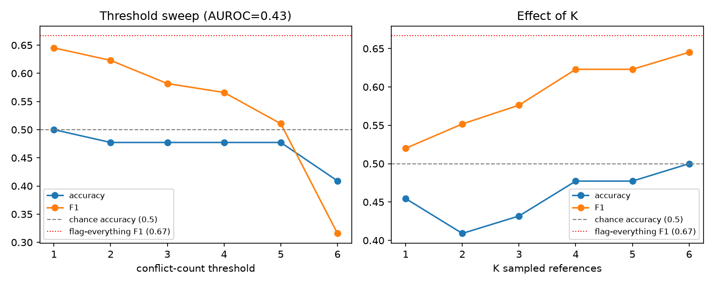

# Self-contradiction hallucination detection with a local LLM (Ollama)

Status: in progress

## Question
With a small local model, how well does self-contradiction detect the model's own factual hallucinations,
and is the "any conflict" rule the best decision rule?

## Method
Idea from AutoHall (Cao et al., arXiv:2310.00259). I re-implemented it from scratch (own code, own prompts, Ollama instead of
ChatGPT/Llama-2); I did not copy the authors' code.
1. `build_dataset.py`: for each Climate-FEVER claim (SUPPORTS/REFUTES only) the model writes a reference, then classifies the
   claim using that reference. If the verdict disagrees with the ground-truth label, the reference is labelled hallucinated.
2. `detect.py`: balance the classes, sample K=6 more references with different prompts, and ask the model whether each
   conflicts with the original. The conflict vector is saved.
3. `analyze.py`: accuracy / precision / recall / F1 / AUROC, a threshold sweep over the conflict count, and a K ablation.

## My extensions
- Conflict-count thresholds and AUROC instead of only the "at least one conflict" rule
- K ablation (cost vs accuracy)
- Manual check of automatic label quality (N examples)

## How to run
```
ollama pull mistral
pip install -r requirements.txt
python build_dataset.py --model mistral --n 80
python detect.py --model mistral
python analyze.py
```
Quick smoke test without Climate-FEVER: add `--csv data/sample_claims.csv` to `build_dataset.py`.

## Results



Setup: 120 Climate-FEVER claims, local Mistral 7B (Ollama). 22 references were labelled hallucinated (18.3%); detection was evaluated on a balanced set of 44 items (22 hallucinated, 22 factual) with K=6 sampled references. Hallucination is the positive class.

**AUROC of conflict count: 0.429**

### Threshold sweep (flag as hallucinated if conflicts >= t; t=1 is the "any conflict" rule)

| Threshold | Accuracy | Precision | Recall | F1 | Flagged % |
|---|---|---|---|---|---|
| 1 | 0.500 | 0.500 | 0.909 | 0.645 | 90.9 |
| 2 | 0.477 | 0.487 | 0.864 | 0.623 | 88.6 |
| 3 | 0.477 | 0.485 | 0.727 | 0.582 | 75.0 |
| 4 | 0.477 | 0.484 | 0.682 | 0.566 | 70.5 |
| 5 | 0.477 | 0.480 | 0.545 | 0.511 | 56.8 |
| 6 | 0.409 | 0.375 | 0.273 | 0.316 | 36.4 |
| *Flag everything (baseline)* | *0.500* | *0.500* | *1.000* | *0.667* | *100* |

### Effect of K ("any conflict" rule using the first k samples)

| K | Accuracy | Precision | Recall | F1 | Flagged % |
|---|---|---|---|---|---|
| 1 | 0.455 | 0.464 | 0.591 | 0.520 | 63.6 |
| 2 | 0.409 | 0.444 | 0.727 | 0.552 | 81.8 |
| 3 | 0.432 | 0.459 | 0.773 | 0.576 | 84.1 |
| 4 | 0.477 | 0.487 | 0.864 | 0.623 | 88.6 |
| 5 | 0.477 | 0.487 | 0.864 | 0.623 | 88.6 |
| 6 | 0.500 | 0.500 | 0.909 | 0.645 | 90.9 |

### Takeaways
- In this setup, conflict count did not separate hallucinated from factual references (AUROC 0.43; with only 44 items this is not clearly different from chance).
- The "any conflict" rule flagged about 91% of references. Its F1 (0.645) is below the F1 of the trivial flag-everything baseline (0.667).
- Raising the threshold did not improve accuracy.
- F1 rises with K only because more references get flagged; accuracy stays near chance (0.5).

### Limitations
Small N (44 balanced items), one small model, the same model writes the references and judges conflicts, labels are automatic (manual label check pending), one dataset, factuality only.


## Notes
Code scaffold written with help from an AI assistant; I ran the experiments and wrote the analysis.

## References
- Cao et al., AutoHall: Automated Factuality Hallucination Dataset Generation for LLMs (arXiv:2310.00259)
- Diggelmann et al., Climate-FEVER (2020)
- Manakul et al., SelfCheckGPT (2023)
